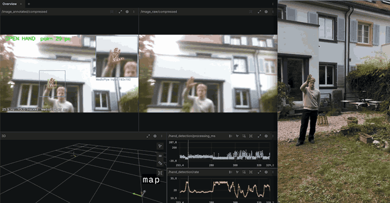

# Eric Hell · Portfolio

Portfolio of Eric Hell, MSc student in Robotics, Systems and Control at ETH Zürich.
The full page with all projects: https://hellerla.github.io/projectoverview/

## VETRA: hand-tracking test

[](assets/vetra-tracking.mp4)

Detection output and processing metrics (left), scene from outside (right). Click the preview for the full-quality video.

## Projects

1. **VETRA**: autonomous drone interception (co-founder)
2. **Real-World-Robotics**: data collection for a dexterous robotic hand (ETH module run by the Soft Robotics Lab)
3. **Digital training signatures at Endress+Hauser**: Python/C++ application, 2'000+ users in 3 plants
4. **Bachelor thesis**: ML micro-macro relations for random fibre networks (grade 6.0/6.0)
5. **CeraSeal**: surgical technology for C-section repair, ETH Focus Project (grade 6.0/6.0)

## Publish with GitHub Pages

1. Upload the contents of this folder (`index.html`, `styles.css`, `assets/`, `README.md`) to the repository root.
2. In the repository go to **Settings → Pages**, choose **Deploy from a branch**, select `main` and `/ (root)`, and save.
3. After a minute or two the site is online at `https://<your-username>.github.io/<repo-name>` (or `https://<your-username>.github.io` if the repository is named `<your-username>.github.io`).

## Local preview

```bash
python3 -m http.server 8000
```

Then open http://localhost:8000.
